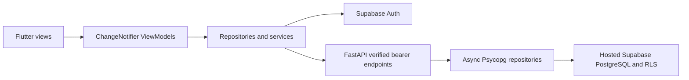

# HomeCircle

Everything your home needs, in one place.

HomeCircle is an Android-first Flutter app with a FastAPI API and Supabase SQL foundation. Authentication/households, inventory, tasks/requests/repairs, and shared shopping are implemented. Hosted acceptance remains pending for M1–4. Chat remains a future milestone. See [the current project status](docs/PROJECT_STATUS.md) before continuing development.

## Project highlights

- Feature-first Flutter MVVM with Provider, typed repositories, and guarded navigation.
- Independent FastAPI service using parameterized async PostgreSQL queries.
- Verified bearer identity, restricted database login, row-level security, and transaction-scoped authorization.
- Household switching that clears stale state and rejects responses from an earlier identity/scope.
- Locked dependencies, unit/widget tests, and optional tests against an isolated hosted database.



For a walkthrough, register/sign in, create a household, inspect membership, create an invitation, and join from a second development account. Use the verification reports below to distinguish implemented flows from external acceptance checks. No production usage or performance claim is implied.

## Structure and architecture

```text
mobile/
  android/, ios/             Flutter-generated platform projects
  lib/main.dart, app.dart    Bootstrap and Provider composition
  lib/core/                 Config, HTTP, guards, theme, localization, local storage
  lib/features/auth/        Views → ChangeNotifier → repository → Supabase Auth
  lib/features/household/   Validated membership and active household lifecycle
  lib/features/dashboard/  Foundation screens and API connection diagnostics
  lib/shared/widgets/      Future-screen placeholder
  test/                    HTTP, routing, session, ViewModel and widget tests
backend/
  app/api/                  Thin versioned FastAPI routers
  app/services/             Business logic and authorization coordination
  app/repositories/         Parameterized async Psycopg SQL
  app/db/                   Lifespan pool and transaction-local verified identity
  app/core/                 Settings, JWT verification and safe errors
  tests/                    Unit tests and opt-in hosted test-project checks
  requirements*.lock        Exact installed dependency versions
supabase/
  migrations/               Tables, RLS, guarded RPCs, private storage buckets
  config.toml               CLI metadata for hosted migration deployment
docs/                       Setup, architecture, environment, security, milestones
```

Flutter uses feature-first MVVM, Provider, ChangeNotifier, `http`, GoRouter, the Supabase Flutter SDK and official Flutter localization. The API uses Pydantic v2, FastAPI, Psycopg 3 async connections and `psycopg_pool`. Inventory, tasks and shopping have their own feature folders. Chat and notifications remain future work. No ORM or additional use-case layer is used.

## Prerequisites

- Flutter stable 3.47.9 / Dart 3.13.7 (versions used here), Android SDK and emulator, JDK 21.
- Python 3.12–3.14; this workspace uses Python 3.13.17.
- A hosted Supabase project and Supabase CLI for remote SQL migrations.
- Xcode and macOS when validating iOS later.

See [setup](docs/setup.md) for Supabase migrations, restricted login provisioning, auth redirects, Android networking, and troubleshooting. See [environment](docs/environment.md) for all settings. Configure private credentials in local files or a deployment secret manager, never in chat or source control.

Supabase hosts PostgreSQL, Auth, Storage and Realtime. FastAPI runs as a Python service and connects to hosted PostgreSQL. The development workflow uses no Docker or local database server.

## Quick start

From the repository root, using PowerShell:

```powershell
python -m venv backend/.venv
cd backend
.venv/Scripts/python -m pip install -r requirements-dev.lock
.venv/Scripts/python -m pip install --no-deps -e .
Copy-Item .env.example .env
# Configure .env locally after applying the Supabase migrations.
.venv/Scripts/python -m uvicorn app.main:create_app --factory --loop app.core.event_loop:create_event_loop --reload --host 0.0.0.0 --no-access-log
```

On macOS/Linux use `.venv/bin/python` instead of `.venv/Scripts/python`. Do not run the API against a privileged `postgres` or service-role database connection: startup rejects it. Database configuration is required even for the running service's health endpoints; isolated unit tests override external dependencies.

In another terminal:

```powershell
cd mobile
flutter pub get
Copy-Item config.example.json config.local.json
# Configure the public Supabase URL/key and API URL locally.
flutter emulators
flutter emulators --launch YOUR_EMULATOR_ID
flutter run -d YOUR_ANDROID_DEVICE_ID --dart-define-from-file=config.local.json
```

Android emulator → host API: `http://10.0.2.2:8000`. For a physical device, prefer `adb reverse tcp:8000 tcp:8000` and `http://127.0.0.1:8000`, or a trusted HTTPS development endpoint. Debug-only HTTP exceptions cover loopback and the emulator host; release builds require HTTPS. With no public configuration, the app displays a development setup screen.

## Checks

```powershell
cd backend
.venv/Scripts/ruff check app tests
.venv/Scripts/ruff format --check app tests
.venv/Scripts/python -m pytest -q
.venv/Scripts/python -m pip check
cd ../mobile
flutter pub get
dart format --output=none --set-exit-if-changed lib test
flutter analyze
flutter test
flutter build apk --debug
```

With the API running, include the two read-only live client checks with `flutter test --dart-define=LIVE_API_BASE_URL=http://127.0.0.1:8000` from `mobile/`. Without that define they are skipped, so normal unit tests require no running service.

The guarded real-database tests require a separate hosted Supabase test project with all migrations applied. They check the declared project identity, refuse the app project's database and isolate test data. Most roll back; concurrency cases commit generated fixture IDs and clean up only those IDs:

```powershell
# Configure the test connection securely in your environment.
$env:HOMECIRCLE_TEST_DB = 'hosted-test'
$env:HOMECIRCLE_TEST_PROJECT_REF = 'YOUR_SEPARATE_TEST_PROJECT_REF'
$env:SUPABASE_URL = 'https://YOUR_APP_PROJECT_REF.supabase.co'
# SUPABASE_TEST_DATABASE_URL must be the test project's admin connection.
cd backend
.venv/Scripts/python -m pytest -m integration -q
```

Use the checked-in `pubspec.lock` and Python locks for repeatable installations. `pyproject.toml` records supported dependency ranges; deliberately update and regenerate locks together when upgrading.

## API

| Endpoint | Access | Purpose |
| --- | --- | --- |
| `GET /health` | Public | `{"status":"ok"}` |
| `GET /api/v1/health` | Public | API availability/version |
| `GET /api/v1/me` | Verified bearer | Own profile and memberships |
| `GET /api/v1/households` | Verified bearer | Own households only |
| `POST /api/v1/households` | Verified bearer | Household + first admin atomically |
| `GET /api/v1/households/{id}` | Verified member | Household detail |

Errors use `{"error":{"code":"...","message":"..."}}`. Request validation returns 422 without echoing input. Missing/invalid tokens return 401 with a Bearer challenge. An absent or inaccessible household returns 404; invalid access does not reveal whether another household exists. Internal failures return a generic 500. Auth key discovery outages return 503. Successful create returns 201. Interactive API docs are at `/docs` outside production.

Read [security](docs/security.md) before extending the API, [architecture](docs/architecture.md) before implementing new features, and [milestones](docs/milestones.md) for verification status. See the [Milestone 1 report](docs/milestone-1-report.md) for the implemented authentication and household flows and external acceptance checks.

See the [verification report](docs/verification.md) for actual dependency versions, command results, Android emulator evidence, and the remaining external setup checklist.

## Milestone 1

Authentication, verification/recovery, profile editing, household create/join/switching, members, admin settings and secure invitation management are implemented. See the [historical implementation report](docs/milestone-1-report.md) for prior checks and remaining real-email acceptance.

## Milestone 2

The inventory API and Flutter module support consumables, durable items, categories,
locations, search/filters, stock/condition changes, activity, private photos and
archive/restore, with scoped cached reading and local form drafts. Hosted migration,
RLS/concurrency and real Storage acceptance remain pending a separate test project.
See [PROJECT_STATUS.md](docs/PROJECT_STATUS.md) for current results, deployment
requirements and the authoritative completion status.

## Milestone 3

Tasks, requests and repairs now have a real API-connected Flutter module: create/edit,
assignment/claim, priority/status/reopen, date/search/filter/archive controls, discussions,
private photos, activity, inventory links, scoped cached reading and local drafts.
Repair completion changes inventory only after a separate explicit confirmation.
The screens adapt the supplied Stitch exports in `UI/` to the shared HomeCircle theme.

Isolated verification: backend **146 passed / 29 skipped**; Flutter **58 passed / 2 skipped**;
Ruff and Flutter analysis clean. The new task migration and live SQL/RLS/Storage
acceptance remain unverified because the separate disposable test project is not configured.
M3 is **Partially Implemented**. M4 is recorded below. See the
[M3 implementation report](docs/milestone-3-report.md) for models, endpoints, files,
design adaptations, test evidence and setup gates, and
[PROJECT_STATUS.md](docs/PROJECT_STATUS.md) for authoritative status.

## Milestone 4

Shared shopping reuses household tasks with one-to-one details and trusted purchase
history. Members can add/edit/claim/assign, purchase, undo and cancel requests,
with exact quantities/prices, inventory links, duplicate awareness and offline
cached reading/local drafts. Stock changes require explicit confirmation and use a
persistent purchase ledger to prevent duplicate quantity increases.

The supplied screen exports now sit directly under `UI/`. Shopping screens adapt
`shared_shopping_list` and `add_shopping_item` to real API data and the shared theme.
Manual/pull refresh and refresh on resume work. Realtime acceptance is pending.
Backend checks report **173 passed / 36 skipped**. Flutter results and Android build
evidence are maintained in [PROJECT_STATUS.md](docs/PROJECT_STATUS.md).
M4 remains **Partially Implemented — hosted acceptance pending**. See the
[M4 report](docs/milestone-4-report.md) for endpoints, constraints, files and setup.
M5 has not started.
